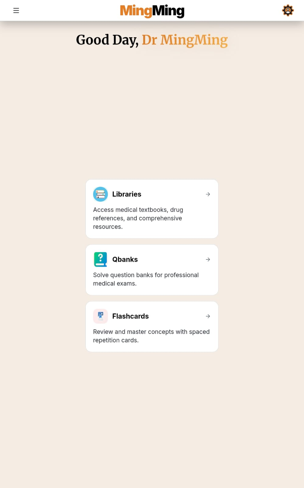
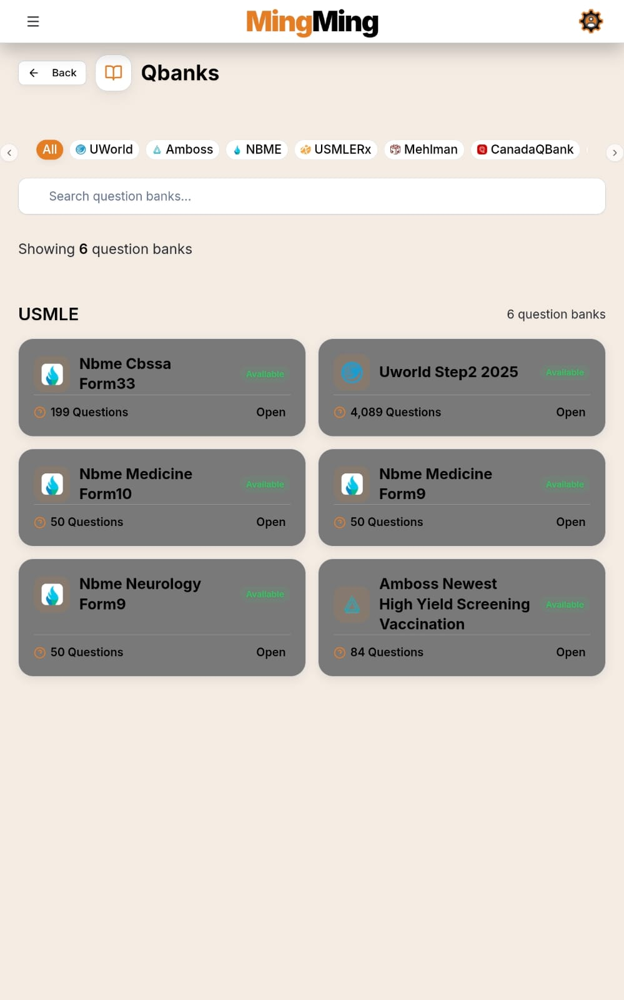
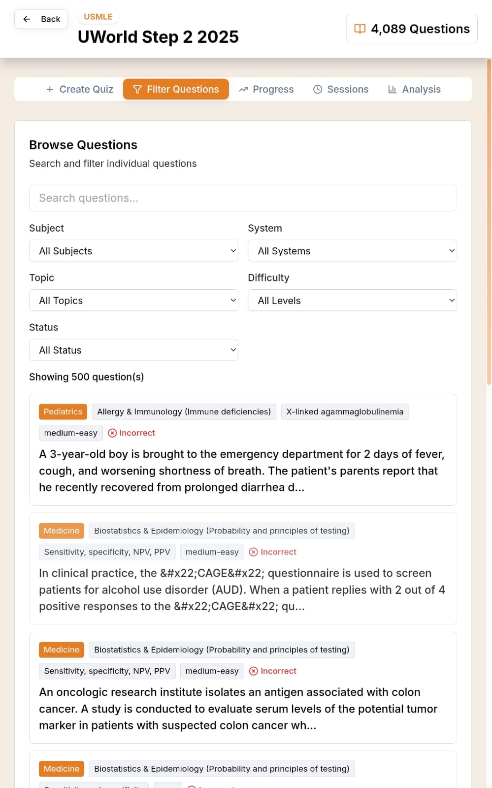
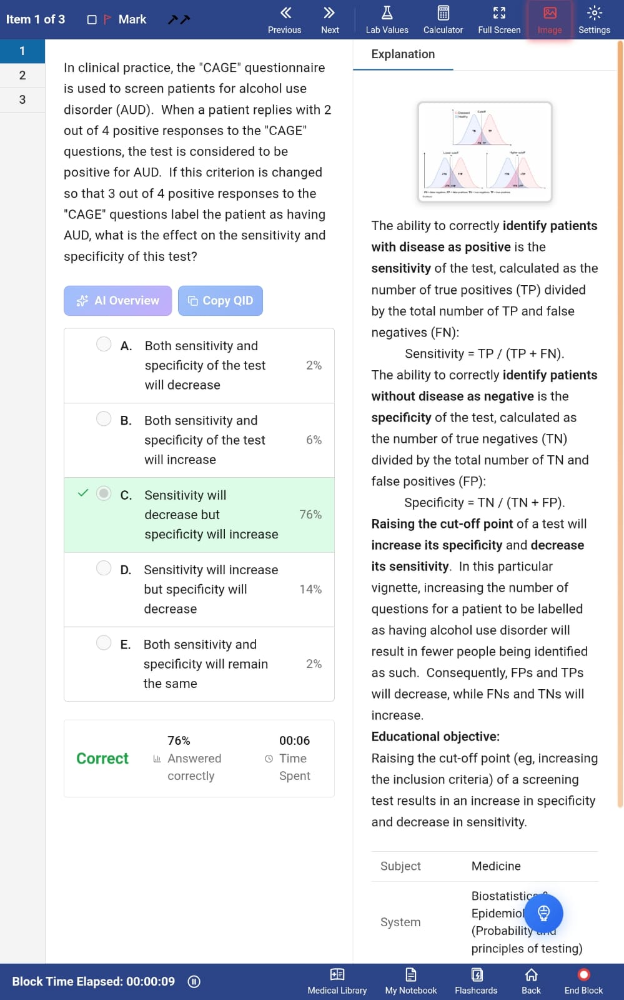
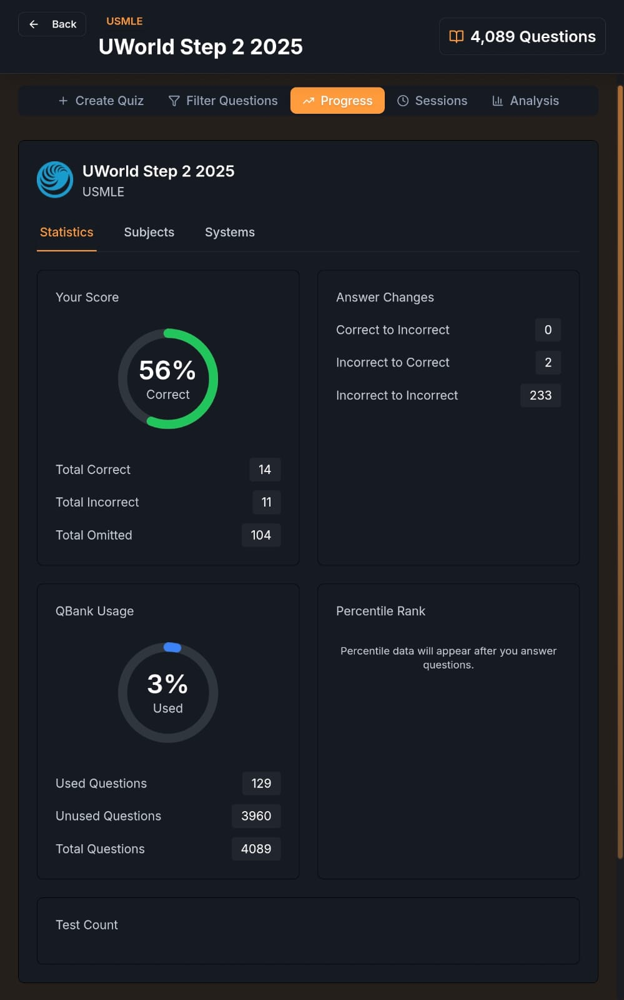
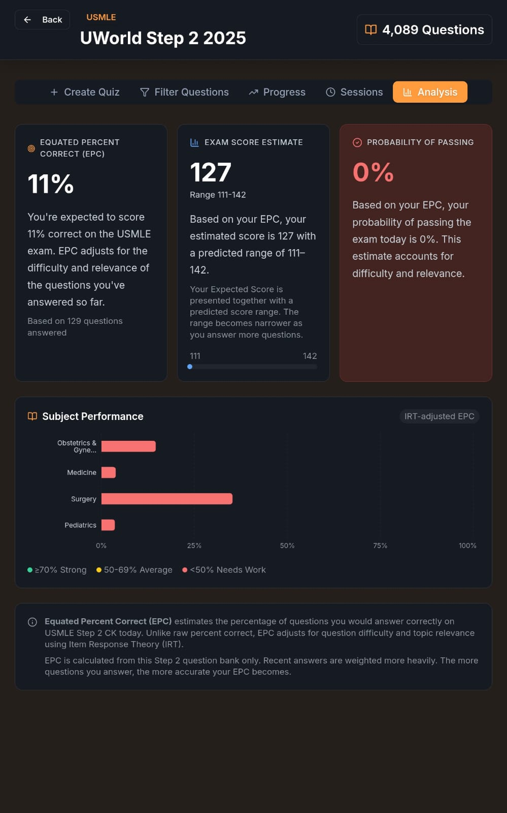
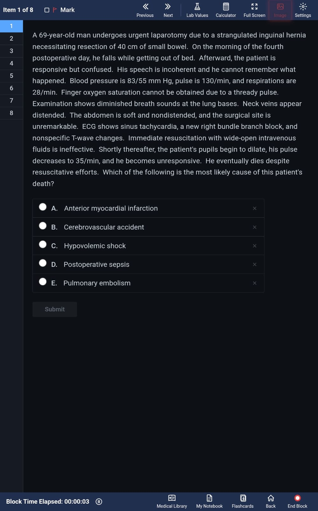
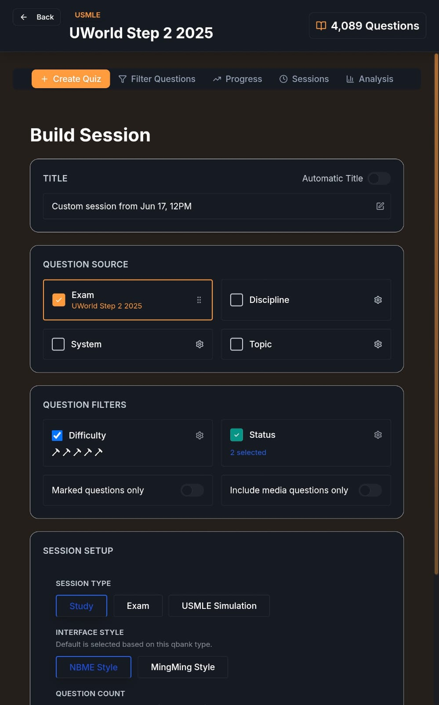

# MingMing

Your all-in-one study companion for medical exam preparation.

[](https://t.me/mingming_khan)
[](https://buymeacoffee.com/mingmingapp)

## About

MingMing is a free, offline-first app designed for students of **all medical and health sciences** fields — whether you're preparing for **MBBS**, **BDS**, **USMLE Step 1 / Step 2 / Step 3**, **MD**, **PLAB**, **UKMLA**, **AMC**, **SMLE**, or studying **Pharmacy**, **Medical Technician**, or any allied health profession.

MingMing reads commonly-distributed unencrypted qbank databases in a standard SQLite folder structure. You provide the databases — MingMing provides the study experience.

**MingMing runs entirely on your device.** All your data stays local — no account, no cloud, no tracking. Internet is only used for optional AI features (Gemini, with your own free API key) and the startup check for app updates (you can skip it for the rest of the day).

## Features

### 📚 Content & Resources
- Supports importing qbank databases in the standard unencrypted SQLite format (`.db` / `.sqlite` / `.sqlite3` / `.bin` files)
- Also supports library databases (article/notes and reference content with table of contents and search, plus clinical workflows such as VisualDX)
- Also supports flashcard databases (qbank-schema databases with `type: "flashcard"` in the manifest)
- See the [Manifest](#manifestjson-and-iconpng) section and the [Schema Docs](docs/) folder for the expected folder structure and table definitions

### 🎨 Beautiful, Polished UI
- Clean, intuitive interface
- 4 app themes: **Light**, **Dark**, **Surgical Scrub**, **Champion Gold**
- Session page colors (reading backgrounds) in **MingMing** and **NBME** modes: **App theme**, **Paper**, **Soft gray**, **Dark**, **Sepia**, **Sage**, **Warm cream**, **Solarized light**, **OLED black**, **Dark sepia**, **Dark sage**

### 🛠️ Customizable Study Sessions
- Build a personalized session by **discipline**, **system**, and **topic**
- Choose between **Study Mode** or **Exam Mode**
- Option to **include previously incorrect questions**
- **Flag** any question for later review
- **Resume** unfinished sessions

### 🖥️ Session Interface Styles
- Choose from **NBME-style**, **Amboss-style**, or the default **MingMing** session interface
- Unique, intuitive default **MingMing style**
- Create **simulation sessions** for compatible qbank formats

### ✏️ During a Session
- **Highlight text** with various colors
- **Create custom flashcards** from within a session
- **Write to notebook** from within a session
- Open related topics in the **library** directly from the session
- Built-in **timer** tracks time per block

### 🤖 AI Integration
- **AI walkthroughs** for any question
- **Chat with AI** in the context of the question you just answered

### 📊 Progress & Analytics
- Track your **progress** in each Qbank
- **Detailed reports** on performance by discipline
- **Predict your exam score** (equated percent correct) based on your performance
- Apply **filters and search** through any Qbank

### 💾 Backup & Cross-Platform
- **Export your settings** as a JSON backup file
- **Import settings** on any device — works cross-platform

## Screenshots

### Windows

    

### Android

   

   

## Download

Go to [**Releases**](https://github.com/Grung-khan/MingMing-releases/releases) to download the latest version.

| Platform | File | Notes |
|---|---|---|
| 🪟 **Windows** | `MingMing Setup X.Y.Z.exe` | Run installer, follow prompts |
| 🤖 **Android** | `MingMing-X.Y.Z.apk` | Enable "Install from unknown sources" if needed |
| 🐧 **Linux (Debian/Ubuntu)** | `MingMing_X.Y.Z_amd64.deb` | `sudo dpkg -i MingMing_X.Y.Z_amd64.deb` |
| 🐧 **Linux (Fedora/RHEL/openSUSE)** | `MingMing-X.Y.Z-1.x86_64.rpm` | `sudo rpm -i MingMing-X.Y.Z-1.x86_64.rpm` (or `sudo dnf install ./MingMing-X.Y.Z-1.x86_64.rpm`) |
| 🌐 **PWA (abandoned)** | [PWA link](https://grung-khan.github.io/MingMing-pwa/) | **No longer maintained.** The web/PWA build is abandoned; native apps above are the supported installs. The old installable PWA may still work in a browser (Add to Home Screen) but will not receive fixes or updates. |

> **PWA status:** abandoned / not maintained. Prefer the native Windows, Android, or Linux builds. There is no native iOS/macOS build.

## How to Use

https://github.com/user-attachments/assets/907f9b20-f454-4a28-9bff-c939d8ebbc78

### Step 1: Install the App

- 🪟 **Windows:** Run `MingMing Setup X.Y.Z.exe` and follow the installer prompts.
- 🤖 **Android:** Open the `.apk` file. If prompted, enable "Install from unknown sources" in your device settings.
- 🐧 **Linux (Debian/Ubuntu):** `sudo dpkg -i MingMing_X.Y.Z_amd64.deb`
- 🐧 **Linux (Fedora/RHEL/openSUSE):** `sudo rpm -i MingMing-X.Y.Z-1.x86_64.rpm` (or `sudo dnf install ./MingMing-X.Y.Z-1.x86_64.rpm`)
- 🌐 **PWA (abandoned):** open the [PWA link](https://grung-khan.github.io/MingMing-pwa/) in a browser and install if desired; **not maintained** and not recommended over native builds. No native iOS/macOS app is provided.

### Step 2: Import Resources (Qbanks/Libraries/Flashcards)

MingMing does not come with databases pre-loaded. You need to import them:

1. Obtain a database ZIP file that you have the right to use.
2. Open MingMing and use the **Import** option.
3. Select the downloaded ZIP file.
4. Wait for the import to finish.
5. Navigate to the appropriate tab (Qbanks, Libraries, or Flashcards) to access your resource.

**ZIP Structure Requirement:** Your ZIP must contain one main folder at the top level with the files inside it. Avoid ZIPs with loose files at the top level.

**Strongly recommended:** the folder should also contain a `manifest.json` (source of truth for the resource's display name, description, publisher, version and tags) and an `icon.png`. Both are optional; without them the resource still imports, but it is shown with a generic name and no attribution.

### Step 3: Manage Resources Manually (Optional)

If you prefer to add or remove resources manually:

**Windows:**
```
C:\Users\{your-username}\AppData\Roaming\MingMing\local-databases\
```

**Linux:**
```
/home/{your-username}/.local/share/MingMing/local-databases/
```

**Android:**

The `Android/data/` folder cannot be accessed directly on most phones. You'll need to:

1. Connect your phone to a PC via USB cable.
2. On your phone, select "File Transfer" mode when prompted.
3. Navigate to `Internal Storage/Android/data/com.mingming.app/files/local-databases/` on your PC.
4. Paste unzipped resource folders into this directory, or delete ones you no longer need.
5. Open MingMing and tap **"Refresh Databases"** in User Settings.

**PWA (abandoned):**

The web/PWA build is no longer maintained. If you still have it installed, it stores data in browser-managed storage — use **Export / Import** (User Settings) to back up or move data. Prefer the native apps for ongoing use.

## Manifest.json and icon.png

Packages ship inside a single top-level folder, and the folder should carry a `manifest.json` alongside the database. The manifest is the source of truth for what the resource shows up as in the app — display name, description, publisher, version, tags, icon and routing. An `icon.png` (the publisher/vendor logo) is shown on the resource's card.

Both files are optional. Without a manifest, the resource still imports via the legacy name-sniffing fallback, but it is shown with a generic name and no attribution.

**A typical manifest:**

```json
{
  "manifestVersion": 1,
  "resourceId": "my-qbank",
  "displayName": "UWorld Step 2 CK 2025",
  "description": "UWorld Step 2 CK question bank, 2025 edition",
  "type": "qbank",
  "publisher": "UWorld",
  "adapter": "qbank",
  "version": "2025",
  "packagedAt": "2026-10-20T12:48:29+00:00",
  "sizeBytes": 677223085,
  "icon": "icon.png",
  "tags": [
    "USMLE",
    "Step 2 CK",
    "QBank"
  ],
  "primaryDb": "my-qbank.db",
  "files": [
    "media/",
    "my-qbank.db",
    "my-qbank.db-shm",
    "my-qbank.db-wal"
  ],
  "searchDb": null,
  "metaScheme": {}
}
```

**Manifest rules:**

- `manifestVersion` must be `1`
- `resourceId` must equal the folder name (canonical compare: case-insensitive, letters and digits only)
- `primaryDb` must name a file that actually exists in the folder
- `type` is `qbank`, `library`, or `flashcard`; `adapter` is one of `qbank`, `article`, `uptodate`, `lexi-drugs`, `visualdx`, `flashcard`, `access-medicine` — pair it via the table below
- `publisher` is the one attribution field (replaces company/author)
- `files` lists every file/folder in the package (rough edge cases like `__MACOSX` are still skipped on import)

**Type ↔ adapter pairings:**

| `type` | valid `adapter` values |
|---|---|
| `qbank` | `qbank` |
| `library` | `article`, `uptodate`, `lexi-drugs` (also `visualdx`, `access-medicine`) |
| `flashcard` | `flashcard` |

**Folder structure:**

```
local-databases/
  my-qbank/                 # folder name = resourceId
    manifest.json            # required for attribution (recommended)
    icon.png                 # optional — publisher logo shown on the resource card
    my-qbank.db              # primary database (.db, .sqlite, .sqlite3, or .bin)
    media/                   # optional, images referenced by the content
    my-qbank.db-shm          # optional SQLite journal files
    my-qbank.db-wal
```

**Rules:**
- Folder name should match the resource id exactly
- The primary DB file must be `.db`, `.sqlite`, `.sqlite3`, or `.bin`
- Files ending in `-wal` or `-shm` are SQLite journal files (kept alongside the DB)
- Files matching `search`, `fts`, or `index` patterns are excluded from primary file selection

---

## Database Schema

MingMing supports three resource types: **qbanks**, **libraries**, and **flashcards**. Each is a folder inside `local-databases/` carrying its manifest and primary database.

The schema documentation is split by resource format / adapter. Pick the one you need:

- [Question Bank Schema](docs/schema-qbank.md) — the `qbank` adapter (Questions, Answers, Subjects, Systems, Refs, Search; linked question sets via `parentQId`/`questionType`)
- [Article Library Schema](docs/schema-article.md) — the `article` adapter (Docs, TOC, Search — UWorld Notes / AMBOSS-style libraries)
- [UpToDate Library Schema](docs/schema-uptodate.md) — the `uptodate` adapter (Docs, TOC + `audience`, Search, Graphics)
- [Lexi-Drugs Schema](docs/schema-lexidocs.md) — the `lexi-drugs` adapter (document, chapter, field, view, viewfield, indexitem, media)
- [VisualDX Schema](docs/schema-visualdx.md) — the `visualdx` library workflow (diagnostic databases + module/body-location configs + icon/image assets)
- [Flashcard Schema](docs/schema-flashcard.md) — the `flashcard` adapter (qbank-schema database with `type: "flashcard"`)

## Getting Help

- **Community Group:** [t.me/mingming_khan](https://t.me/mingming_khan) — Join for updates, discussion, and support. This is a community-run group. MingMing is not affiliated with or endorsed by any qbank provider. Please verify the authenticity and legality of any resources shared by third parties.
- **Support the Project:** If MingMing has helped you, consider <a href="https://buymeacoffee.com/mingmingapp"></a> to keep the project going.
- **Bug Reports & Feature Requests:** [Open an Issue](https://github.com/Grung-khan/MingMing-releases/issues)

## License

MingMing is free software. It does not ship with, distribute, or provide access to any third-party copyrighted qbank content. All database files must be obtained and used in compliance with applicable laws and the terms of their respective owners. MingMing does not grant any rights to use third-party content.

The use of trademarked names (uWorld, Amboss, NBME, USMLE-Rx, Mehlman, etc.) is solely to describe format compatibility and does not imply affiliation, endorsement, or association with any qbank provider.

You are solely responsible for ensuring that any databases you import were obtained legally and that your use of them complies with applicable terms of service and copyright law.
