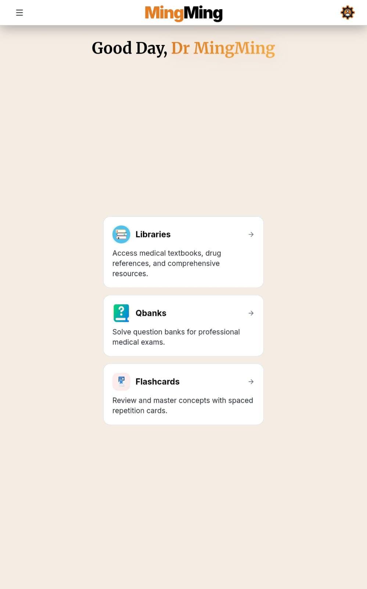
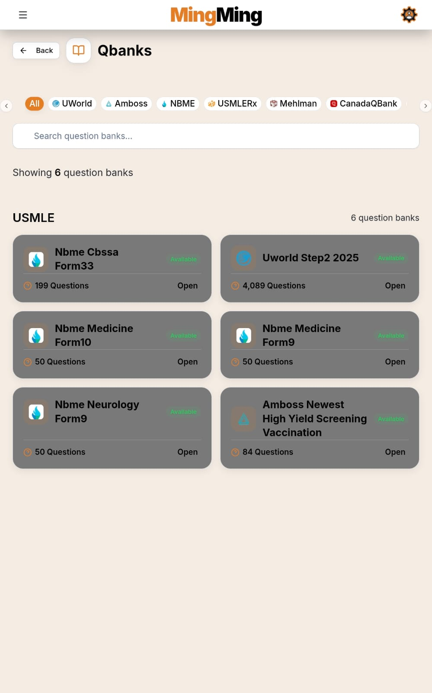
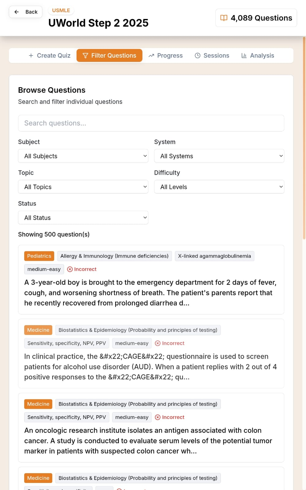
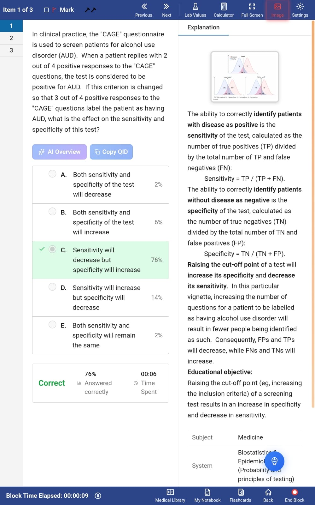
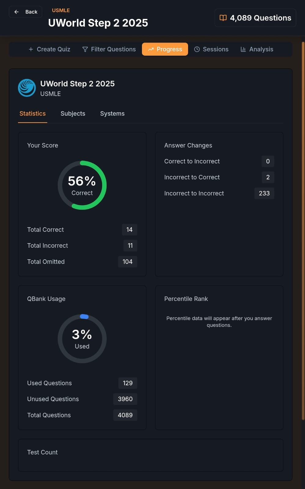
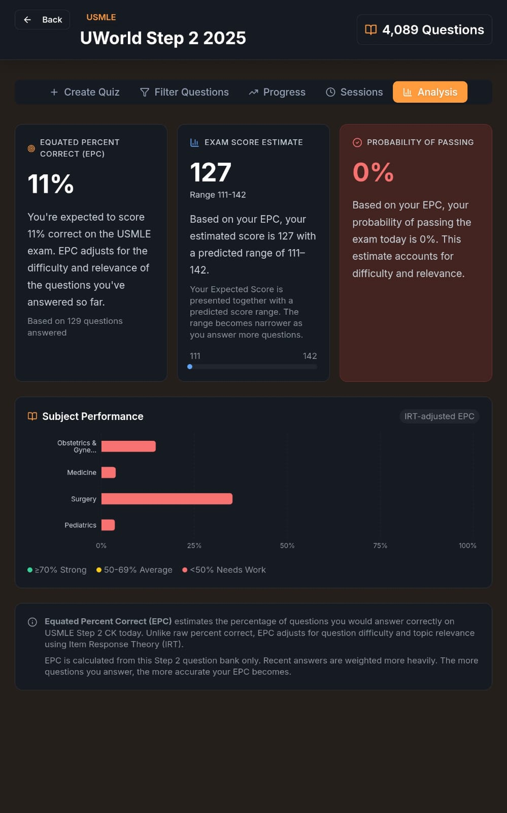
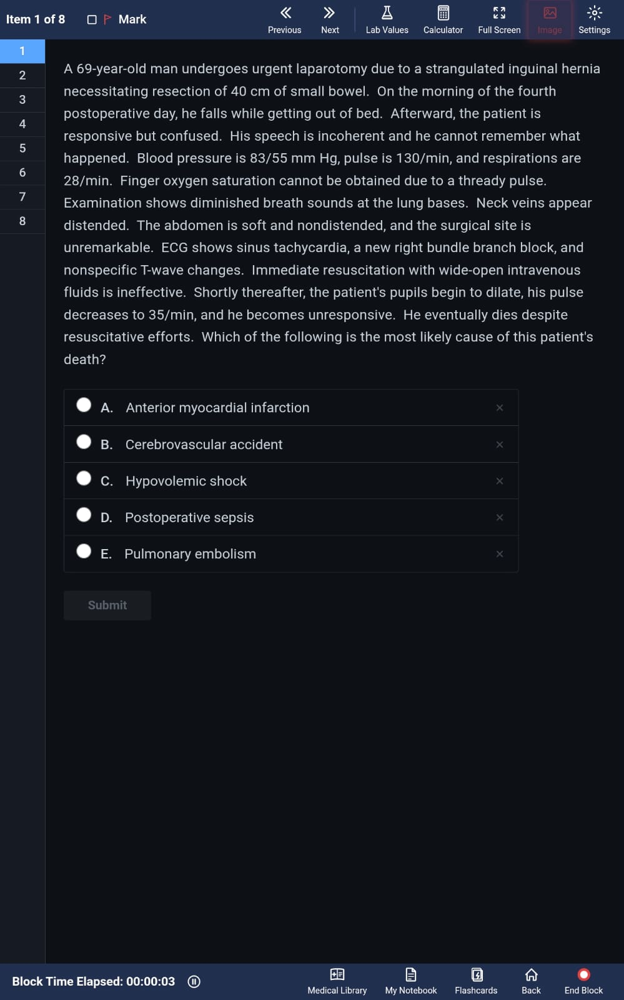
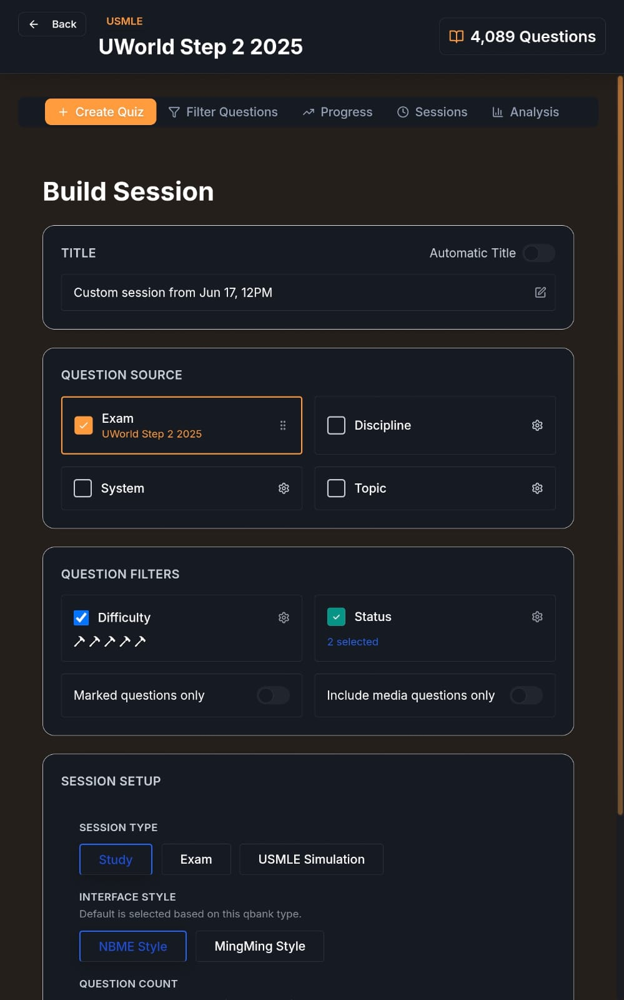

# MingMing

Your all-in-one study companion for medical exam preparation.

[](https://t.me/mingming_khan)

## About

MingMing is a free, offline-first app designed for students of **all medical and health sciences** fields — whether you're preparing for **MBBS**, **BDS**, **USMLE Step 1 / Step 2 / Step 3**, **MD**, **PLAB**, **UKMLA**, **AMC**, **SMLE**, or studying **Pharmacy**, **Medical Technician**, or any allied health profession.

MingMing reads commonly-distributed unencrypted qbank databases in a standard SQLite folder structure. You provide the databases — MingMing provides the study experience.

**MingMing runs entirely on your device.** All your data stays local — no account, no cloud, no tracking. Internet is only needed for AI features (Gemini integration with a free API key).

## Features

### 📚 Content & Resources
- Supports importing qbank databases in the standard unencrypted SQLite format (`.db` / `.sqlite` / `.sqlite3` / `.bin` files)
- Also supports library databases (article-style content with table of contents and full-text search)
- Also supports flashcard databases (both qbank-style and Anki-compatible formats)
- See the [Database Schema](#database-schema) section for the expected folder structure and table definitions

### 🎨 Beautiful, Polished UI
- Clean, intuitive interface
- 7 themes: **Light**, **Dark Mode**, **Surgical Scrub**, **Petri Dish**, **Champion Gold**, **Biohazard**, **Neon Virus**

### 🛠️ Customizable Study Sessions
- Build a personalized session by **discipline**, **system**, and **topic**
- Choose between **Study Mode** or **Exam Mode**
- Option to **include previously incorrect questions**
- **Flag** any question for later review
- **Resume** unfinished sessions

### 🖥️ Session Interface Styles
- Choose from **NBME-style**, **Amboss-style**, or the default **MingMing** session interface
- Unique, intuitive default **MingMing style**
- Create **simulation sessions** for compatible qbank formats

### ✏️ During a Session
- **Highlight text** with various colors
- **Create custom flashcards** from within a session
- **Write to notebook** from within a session
- Open related topics in the **library** directly from the session
- Built-in **timer** tracks time per block

### 🤖 AI Integration
- **AI walkthroughs** for any question
- **Chat with AI** in the context of the question you just answered

### 📊 Progress & Analytics
- Track your **progress** in each Qbank
- **Detailed reports** on performance by discipline
- **Predict your exam score** (equated percent correct) based on your performance
- Apply **filters and search** through any Qbank

### 💾 Backup & Cross-Platform
- **Export your settings** as a JSON backup file
- **Import settings** on any device — works cross-platform

## Screenshots

### Windows

    

### Android

   

   

## Download

Go to [**Releases**](https://github.com/Grung-khan/MingMing-releases/releases) to download the latest version.

| Platform | File | Notes |
|---|---|---|
| 🪟 **Windows** | `MingMing Setup X.Y.Z.exe` | Run installer, follow prompts |
| 🤖 **Android** | `MingMing-X.Y.Z.apk` | Enable "Install from unknown sources" if needed |
| 🐧 **Linux (Debian/Ubuntu)** | `MingMing_X.Y.Z_amd64.deb` | `sudo dpkg -i MingMing_X.Y.Z_amd64.deb` |
| 🍏 **iOS / macOS** | Installable PWA | Open the [PWA link](https://grung-khan.github.io/MingMing-pwa/) in Safari, tap Share → Add to Home Screen — works fully offline after first load |
| 🌐 **Any platform** | Installable PWA | Chrome / Edge / Samsung Internet: open the [PWA link](https://grung-khan.github.io/MingMing-pwa/) and install from the address bar |

> **PWA (Progressive Web App)** — Works offline, stores all data locally on your device, and runs just like a native app. No account, no cloud, no tracking.

## How to Use

https://github.com/user-attachments/assets/907f9b20-f454-4a28-9bff-c939d8ebbc78

### Step 1: Install the App

- 🪟 **Windows:** Run `MingMing Setup X.Y.Z.exe` and follow the installer prompts.
- 🤖 **Android:** Open the `.apk` file. If prompted, enable "Install from unknown sources" in your device settings.
- 🐧 **Linux:** Download the `.deb` file and install with `sudo dpkg -i MingMing_X.Y.Z_amd64.deb`.
- 🍏 **iOS / macOS:** Open the [PWA link](https://grung-khan.github.io/MingMing-pwa/) in Safari, tap **Share** → **Add to Home Screen**.
- 🌐 **Other platforms:** Open the [PWA link](https://grung-khan.github.io/MingMing-pwa/) in Chrome/Edge and install from the address bar.

### Step 2: Import Resources (Qbanks/Libraries/Flashcards)

MingMing does not come with databases pre-loaded. You need to import them:

1. Obtain a database ZIP file that you have the right to use.
2. Open MingMing and use the **Import** option.
3. Select the downloaded ZIP file.
4. Wait for the import to finish.
5. Navigate to the appropriate tab (Qbanks, Libraries, or Flashcards) to access your resource.

**ZIP Structure Requirement:** Your ZIP must contain one main folder at the top level with the files inside it. Avoid ZIPs with loose files at the top level.

### Step 3: Manage Resources Manually (Optional)

If you prefer to add or remove resources manually:

**Windows:**
```
C:\Users\{your-username}\AppData\Roaming\MingMing\local-databases\
```

**Linux:**
```
/home/{your-username}/.local/share/MingMing/local-databases/
```

**Android:**

The `Android/data/` folder cannot be accessed directly on most phones. You'll need to:

1. Connect your phone to a PC via USB cable.
2. On your phone, select "File Transfer" mode when prompted.
3. Navigate to `Internal Storage/Android/data/com.mingming.app/files/local-databases/` on your PC.
4. Paste unzipped resource folders into this directory, or delete ones you no longer need.
5. Open MingMing and tap **"Refresh Databases"** in User Settings.

**PWA (iOS / macOS / other platforms):**

PWAs store data in browser-managed storage. Use the app's **Export / Import** feature (in User Settings) to back up and restore your resources across devices.

## Database Schema

MingMing supports three resource types: **qbanks**, **libraries**, and **flashcards**. Each is a folder inside `local-databases/` containing at least one SQLite database file.

### Folder Structure

```
local-databases/
  my-resource-name/          # folder name = resource id (lowercase, hyphenated)
    my-resource-name.db      # primary database file (.db, .sqlite, .sqlite3, or .bin)
    media/                   # optional: images referenced by questions
    search.db                # optional: full-text search index (auto-excluded from primary)
```

**Rules:**
- Folder name should match the resource id exactly
- The primary DB file must be `.db`, `.sqlite`, `.sqlite3`, or `.bin`
- Files ending in `-wal` or `-shm` are SQLite journal files (ignored by selection, but kept alongside the DB)
- Files matching `search`, `fts`, or `index` patterns are excluded from primary file selection

---

### Qbank Schema

A qbank database requires four tables:

#### `Questions`

| Column | Type | Required | Description |
|---|---|---|---|
| `id` | INTEGER | Yes | Primary key |
| `question` | TEXT | Yes | Question stem (HTML) |
| `explanation` | TEXT | Yes | Explanation (HTML) |
| `corrAns` | TEXT | Yes | Correct answer letter(s), e.g. `"A"` or `"B,D"` |
| `subId` | TEXT | Yes | Comma-separated subject IDs, e.g. `"3,5"` |
| `sysId` | TEXT | Yes | Comma-separated system IDs, e.g. `"2,7"` |
| `title` | TEXT | Yes | Question title or one-line description |
| `mediaName` | TEXT | No | Primary image filename (relative to `media/` folder) |
| `otherMedias` | TEXT | No | Additional media filenames |
| `pplTaken` | INTEGER | No | Total people who took this question (NBME-style stats) |
| `corrTaken` | INTEGER | No | People who answered correctly (NBME-style stats) |

#### `Answers`

| Column | Type | Required | Description |
|---|---|---|---|
| `id` | INTEGER | Yes | Primary key |
| `qId` | INTEGER | Yes | Foreign key → `Questions.id` |
| `answerId` | INTEGER | Yes | Answer option number (1-based) |
| `answerText` | TEXT | Yes | Answer option text |
| `correctPercentage` | REAL | No | Percentage of users who selected this option |

#### `Subjects`

| Column | Type | Required | Description |
|---|---|---|---|
| `id` | INTEGER | Yes | Primary key (referenced by `Questions.subId`) |
| `name` | TEXT | Yes | Subject/discipline name |

#### `Systems`

| Column | Type | Required | Description |
|---|---|---|---|
| `id` | INTEGER | Yes | Primary key (referenced by `Questions.sysId`) |
| `name` | TEXT | Yes | Body system name |

**Minimum viable qbank query:**
```sql
SELECT COUNT(*) FROM Questions;
SELECT id, question, explanation, corrAns, subId, sysId, title FROM Questions;
SELECT id, qId, answerId, answerText FROM Answers WHERE qId = ?;
SELECT id, name FROM Subjects;
SELECT id, name FROM Systems;
```

---

### Library Schema (Docs + TOC)

A library database requires three tables:

#### `Docs`

| Column | Type | Required | Description |
|---|---|---|---|
| `id` | INTEGER | Yes | Primary key |
| `title` | TEXT | Yes | Article title |
| `doc` | TEXT | Yes | Article content (HTML) |

#### `TOC`

| Column | Type | Required | Description |
|---|---|---|---|
| `id` | INTEGER | Yes | Primary key |
| `name` | TEXT | Yes | TOC entry name |
| `docId` | INTEGER | Yes | Foreign key → `Docs.id` |
| `parentId` | INTEGER | Yes | Parent TOC entry (0 = root) |
| `leaf` | INTEGER | Yes | 1 if leaf node, 0 if has children |
| `section` | TEXT | No | Section grouping |
| `audience` | TEXT | No | Target audience |

#### `Search`

| Column | Type | Required | Description |
|---|---|---|---|
| `text` | TEXT | Yes | Search term |
| `content` | TEXT | Yes | FTS content (queried with `MATCH`) |
| `contentId` | INTEGER | Yes | Foreign key → `Docs.id` |

**Minimum viable library query:**
```sql
SELECT COUNT(*) FROM Docs;
SELECT id, title, doc FROM Docs WHERE id = ?;
SELECT id, name, docId, parentId, leaf FROM TOC WHERE parentId = 0;
SELECT id, name, docId, parentId, leaf FROM TOC WHERE parentId = ?;
SELECT text, contentId FROM Search WHERE content MATCH ?;
```

---

## Getting Help

- **Community Group:** [t.me/mingming_khan](https://t.me/mingming_khan) — Join for updates, discussion, and support. This is a community-run group. MingMing is not affiliated with or endorsed by any qbank provider. Please verify the authenticity and legality of any resources shared by third parties.
- **Bug Reports & Feature Requests:** [Open an Issue](https://github.com/Grung-khan/MingMing-releases/issues)

## License

MingMing is free software. It does not ship with, distribute, or provide access to any third-party copyrighted qbank content. All database files must be obtained and used in compliance with applicable laws and the terms of their respective owners. MingMing does not grant any rights to use third-party content.

The use of trademarked names (uWorld, Amboss, NBME, USMLE-Rx, Mehlman, etc.) is solely to describe format compatibility and does not imply affiliation, endorsement, or association with any qbank provider.

You are solely responsible for ensuring that any databases you import were obtained legally and that your use of them complies with applicable terms of service and copyright law.
